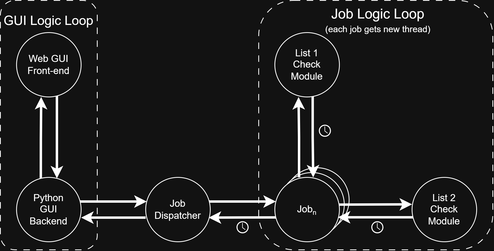

# The Ice Scraper - Troy Hack 2026
##### This project was created for Troy Hack 2026, a 24-hour hackathon hosted by Troy University. It received 3rd place in the competition.

TODO: Add brief description of project and credits.

## Table of Contents
- [Objective](#objective)
- [Features](#features)
- [Program Design](#program-design)
- [Detection Techniques](#detection-techniques)
- [Running](#running)

## Objective

TODO: Add a description of the objective of the project.

## Features

TODO: Add a description of the features of the project.

## Program Design

TODO: Add description of program design and the collaborative and maintenance benefits of this design.

TODO: Add a diagram and explanation of the design of each list check module.

## Detection Techniques

TODO: Add a description of how the program flags potentially sensitive content.

## Running

TODO: Add instructions for running the program, including any dependencies or setup required.