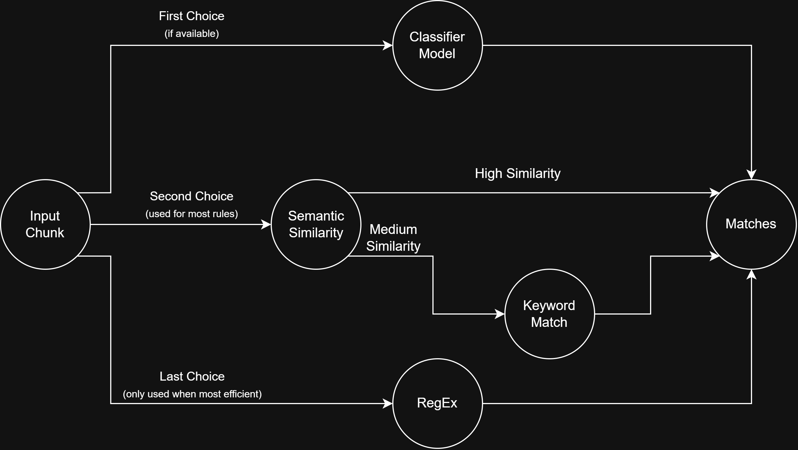

# The Ice Scraper - Troy Hack 2026
##### This project was created for Troy Hack 2026, a 24-hour hackathon hosted by Troy University. It received 3rd place in the competition.

TODO: Add brief description of project and credits.

## Table of Contents
- [Objective](#objective)
- [Features](#features)
- [Program Design](#program-design)
- [Detection Techniques](#detection-techniques)
- [Running](#running)

## Objective

The Ice Scraper is a tool that scans documents for topics that may need to be redacted before being shared with the public.
It does not make the final decision on whether a document is ready to publish or not. Rather, it is a tool that 
aims to streamline and assist the review process by identifying which documents and what parts are most likely to need extra attention.

## Features

TODO: Expand on the features
### Issue Highlighting
### Quick Navigation
### Document Triage 
### Batch Processing


### Fully Offline
Ice Scraper can be used fully offline (after it is run online at least once to install models) by setting the following environment variables before running:
```shell
set HF_HUB_OFFLINE=1
set HF_DATASETS_OFFLINE=1
set TRANSFORMERS_OFFLINE=1
```
This allows critical data to stay on device, never touching the cloud, ensuring sensitive information never leaves the host machine.

## Program Design


### System Modularity
The Ice Scraper is designed with modularity in mind, which allowed for easier collaboration during the hackathon,
but also allows for easier maintenance and future development.
The program is divided into two main sections: the GUI logic loop and the job logic loop, with a job dispatcher acting as a middleman between them.
The front-end of the GUI provides a web-based interface for users to easily interact with the program and organize and triage issues with documents.
The Python back-end of the GUI loop passes requests to the job dispatcher and receives results back to display to the user.
The job dispatcher maintains the status of all the requested jobs and creates new jobs on new threads upon request.
The job logic loop handles the actual document processing and issue detection, with modules for each list of rules.
Additional modules can easily be added to the job logic loop to expand the program's capabilities.


### Module Functions
Modules are further broken down into individual functions for each rule.
Each function checks for violations of a specific rule and adds to the list of issues if one is found.
Because each rule is its own function, different rules can use the best detection technique for its specific task.
This allows for greater expandability with new rules in the future, as well as allowing for a better balance between accuracy and performance.

## Detection Techniques

TODO: Add a description of how the program flags potentially sensitive content.

## Running

TODO: Add instructions for running the program, including any dependencies or setup required.